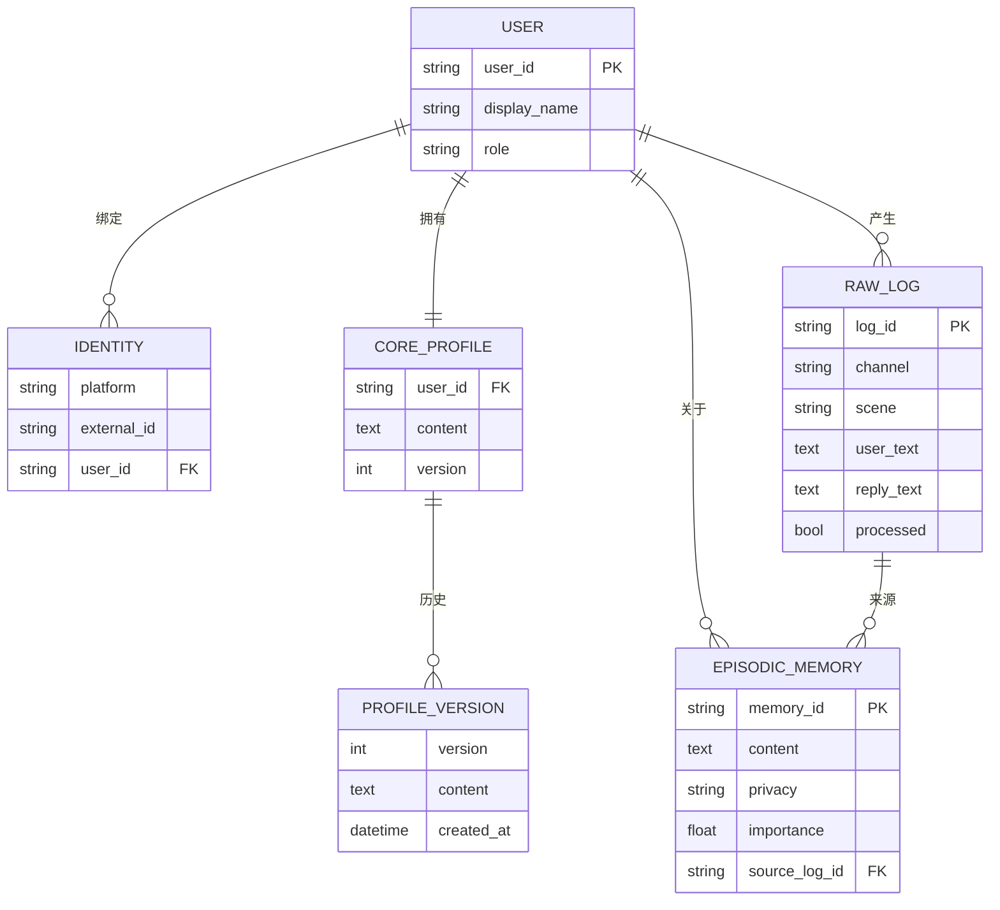
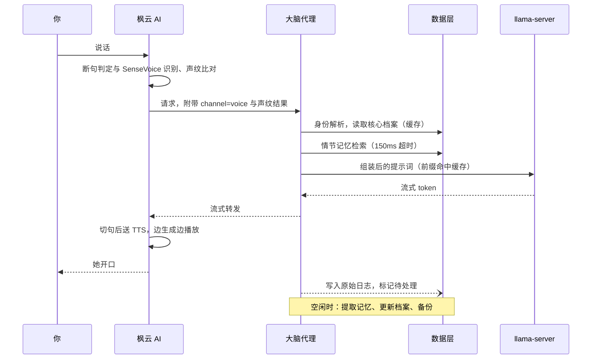
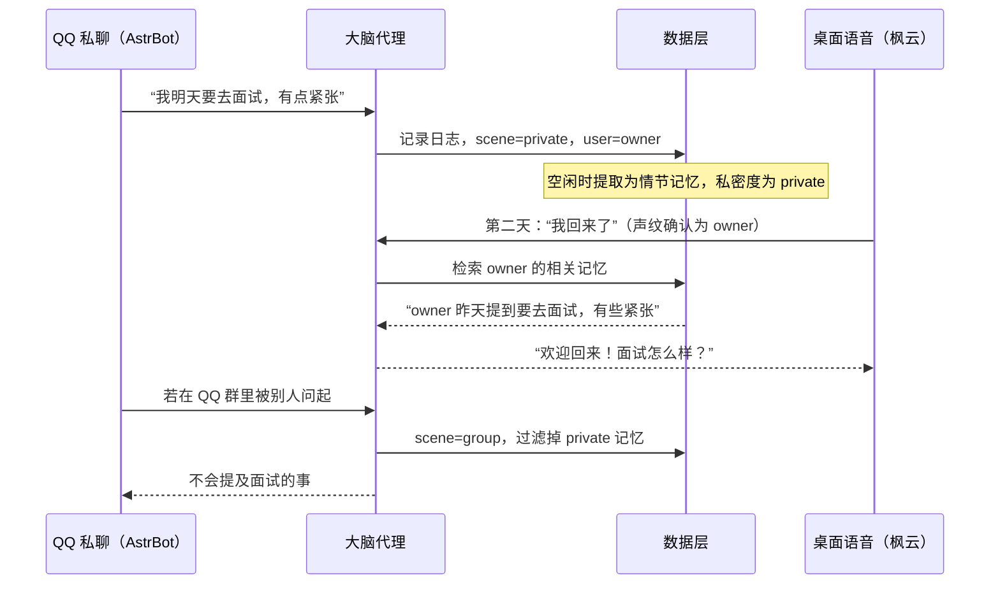

# 她的架构 · 第一阶段：稳定的记忆，及时的回应

在本地 RTX 5070 Ti 主机上，让 AstrBot（QQ 等聊天平台）和枫云 AI 助手（桌面语音）共用同一个“她”：同一份人设、同一套长期记忆，并且开口足够快。

**长期记忆稳定**记得住、记得对、不串场合、不会因为一次错误提取就永久记错，数据可备份可回滚。

**回答速度**语音对话从你说完到她开口，目标 1.5 秒左右；文字聊天首字 1 秒内。记忆功能不能拖慢回复。

**本阶段范围：**数据层、大脑代理、枫云 AI 与 AstrBot 的完整互动流程。小鸭机器人只预留接口，不做具体实现。

## 1需求与约束

| 类别 | 内容 |
| --- | --- |
| 部署 | 全部本地运行，单机 RTX 5070 Ti（16GB 显存），单人或少量用户使用。 |
| 入口 | AstrBot 负责 QQ 等文字聊天；枫云 AI 助手负责桌面语音对话、声纹识别和 Live2D/VRM 形象。 |
| 一致性 | 两个入口共享人设和长期记忆，能把不同平台上的同一个人认作同一人；私密记忆不在公开场合出现。 |
| 已有资产 | AstrBot 使用经验、RVC 音色模型与素材。 |
| 后续扩展 | 小鸭机器人、唱歌、游戏、直播。本阶段架构要为它们留好接口。 |

## 2整体架构

两个入口都把 LLM 地址指向大脑代理。大脑代理伪装成 OpenAI 兼容接口，在转发给本地模型前注入人设和记忆，回复后在后台异步写入记忆。灰色虚线部分为下一阶段内容。

图 1 第一阶段整体架构。读路径与写路径分离，是兼顾“稳定”与“速度”的关键。

## 3开源项目选型：长期记忆

选型标准按本项目的优先级排列：能否完全本地运行、读路径延迟、记忆纠错能力、与“大脑代理”架构的契合度、维护活跃度。需要注意，这个领域的公开评测分数大多由各项目自己发布，彼此不可直接比较；同一个评测名下，独立第三方测出的 Mem0 分数与官方数字相差 45 分以上。所以下表重点比较架构与工程特性，最终以自己的对话数据实测为准。

| 项目 | 记忆模型 | 许可 | 本地部署 | 读路径速度 | 稳定性特点 | 结论 |
| --- | --- | --- | --- | --- | --- | --- |
| Mem0（开源版） | LLM 提取事实，再与已有记忆比对，决定新增、更新、删除或不动 | Apache-2.0 | Python SDK，支持 Ollama 等本地模型与 Qdrant | 一次向量检索，快 | 有显式的更新与删除机制；但每次写入都靠 LLM 判断，错误更新会覆盖旧事实 | 作为情节记忆引擎 |
| Zep / Graphiti | 时序知识图谱，事实带有效期，旧事实被标记失效而非删除 | Apache-2.0 | 需另配 Neo4j、FalkorDB 或 Kuzu；自带服务端的社区版已停止维护 | 官方称亚秒级 | 可追溯“什么时候改变了看法”，纠错最可靠；但建图对本地小模型的结构化输出要求高 | 后期备选 |
| Letta（原 MemGPT） | 分层记忆，由智能体通过工具调用自行编辑；空闲时由第二个智能体整理 | Apache-2.0 | 需运行它的服务端，并接管整个智能体运行时 | 依赖工具调用，多一轮推理 | “空闲整理”思路非常好，值得借鉴 | 不直接采用，借鉴思路 |
| MemOS（记忆张量） | “记忆操作系统”，支持文本、KV 缓存、参数化等多种记忆 | Apache-2.0 | 提供 REST API 与 Docker；可接 Ollama，图后端为 Neo4j / NebulaGraph | 取决于配置 | 功能全、中文资料多，但体量较大 | 备选，适合深入研究 |
| Memobase | 以用户档案为核心，加事件时间线 | Apache-2.0 | FastAPI + Postgres + Redis | 档案读取官方称 100ms 内 | “始终注入用户档案”的设计非常适合陪伴类角色 | 借鉴档案设计；近期更新放缓 |
| LivingMemory（AstrBot 插件） | BM25 + 向量混合检索，记忆原子化，带重要度与时间衰减 | AGPL-3.0 | 装在 AstrBot 内即可用 | 快 | 有备份、回滚与身份别名，成熟度高 | 只服务 AstrBot，无法跨入口共享 |

### 推荐方案：三层记忆，Mem0 为引擎，自研核心档案

稳定性的关键不在于选哪个库，而在于分层：最重要、最常用的信息放在每次必注入的小档案里；零散经历放进可检索的情节记忆；原始对话全部留底，任何一层出错都能从原始日志重新生成。

图 2 三层记忆。读的时候只碰第一、二层；写的时候从第三层出发，由后台任务逐层更新。

### 保证记忆稳定的具体措施

- 写入不在回复路径上：回复结束后只把原文落库，提取与更新排队到空闲时执行，避免与对话抢显卡。
- 每次更新或删除都留旧版本：情节记忆与核心档案都有版本号，出错可以回滚到任意时间点。
- 重要事实需要多次确认：被多次提到或你明确说“记住”的内容，重要度才会提高并进入核心档案。
- 来源可追溯：每条记忆记录来自哪条原始日志，必要时可以对照原文重新提取。
- 私密度在写入时标注：私聊和语音默认标为私密，群聊为公开；读取时按当前场合过滤。
- 建立自己的回归测试：准备 30 到 50 个“她应该记得什么”的问题，每次升级模型或提示词后跑一遍。

## 4开源项目选型：回答速度

语音对话的等待时间由多段串联组成。下图是 5070 Ti 上的目标预算，各段数值为规划目标，需要部署后实测校准。

图 3 语音对话延迟预算（毫秒）。文字聊天不经过断句、ASR 和 TTS，首字目标 1 秒内。

### 推理引擎

| 方案 | 优点 | 缺点 | 结论 |
| --- | --- | --- | --- |
| llama.cpp（llama-server） | 单用户解码速度最好；支持提示词前缀缓存、KV 缓存量化；OpenAI 兼容接口 | 参数需要手动调 | 主力 |
| Ollama | 上手最简单，枫云与 AstrBot 都原生支持 | 有实测显示在部分显卡上解码速度只有原生 llama.cpp 的一半左右 | 调试期可用 |
| vLLM / SGLang | 高并发吞吐强 | 单用户场景优势不明显，显存占用大，会挤占 TTS 的空间 | 不采用 |

### 对话模型

16GB 显存的公开实测中，Qwen3 14B 全部放在显卡上时，解码速度约每秒 60 token，占用约 12GB（含较长上下文）。本项目还要同时运行 TTS 和嵌入模型，建议从 14B 级 Q4 量化、8K 上下文起步，显存不够时退到 8B 级。陪伴聊天要关闭“思考模式”，否则首字会被思考过程拖慢好几秒。具体型号以部署时最新的 Qwen 系列为准。

### 语音合成

| 方案 | 首包延迟 | 音色 | 结论 |
| --- | --- | --- | --- |
| GPT-SoVITS | 支持流式模式，延迟需实测 | 可用你现有素材训练专属音色，效果可控 | 先用，实测达标即保留 |
| Qwen3-TTS | 官方 0.6B 模型约 97ms | 零样本克隆，几秒参考音频即可；Apache-2.0；枫云已支持 | 速度不达标时的首选替代 |
| CosyVoice2 | 官方称流式约 150ms | 中文与方言好 | 备选 |
| IndexTTS2 | 偏慢 | 情感与时长控制强，适合配音 | 不用于实时对话 |

语音识别继续用枫云内置的 SenseVoice，速度与中文效果都足够。RVC 只用于唱歌，不放进实时链路。

### 大脑代理自身的提速手段

- 提示词分“静态前缀”和“动态部分”：人设放最前面且永不变动，llama.cpp 的前缀缓存就能复用，每次只需计算后面的档案、记忆和对话。
- 记忆检索设 150ms 超时：超时就只带核心档案回复，保证速度底线。
- 全程流式：大脑代理边收边转发，枫云按句号、问号等切句后立即送 TTS。
- 写入延后：提取记忆要调用 LLM，统一在空闲时执行，避免与对话争抢显卡。
- 模型常驻显存：对话、嵌入、TTS 模型启动后都不卸载，避免冷启动。

## 5数据层设计

结构化数据放在 SQLite（单文件，备份方便，单用户性能足够），向量放在 Qdrant，人设放在 Git 管理的 YAML 文件里。三者都纳入每日快照。



图 4 数据模型。情节记忆的向量与正文由 Mem0 存入 Qdrant，元数据中保存来源日志编号与私密度。

| 数据 | 存储 | 说明 |
| --- | --- | --- |
| 人设 | `persona/her.yaml` | 唯一来源，用 Git 记录每次修改；修改后需重启代理或调用重载接口。 |
| 身份表 | SQLite `identity` | 例如 `qq:123456`、`voice:owner` 都映射为 `owner`；未登记的人自动建为访客。 |
| 核心档案 | SQLite `core_profile` | 每个用户一份，另有一份“她自己”的档案；每次改写都存入历史版本。 |
| 情节记忆 | Qdrant（经 Mem0） | 元数据：`user_id`、`privacy`、`importance`、`source_log_id`。 |
| 原始日志 | SQLite `raw_log` | 含入口、场景（私聊、群聊、语音）、`processed` 标记，供后台任务消费。 |
| 近期动态 | 内存 + SQLite | 跨入口的最近几条对话摘要，让她在语音里也知道你刚才在 QQ 说了什么。 |

## 6大脑代理设计

### 提示词组装顺序

顺序按“从不变到常变”排列，以最大化前缀缓存的命中。

```
[1] 人设与说话风格            ← 静态，永远相同，可被缓存
[2] 行为规则（场合、隐私）     ← 静态
[3] 当前场景：入口、私聊/群聊、在场的人
[4] 核心档案：当前用户 + 她自己
[5] 相关情节记忆（≤5 条，已按场合过滤）
[6] 跨入口近期动态
[7] 入口传来的近期对话 + 本轮消息
```

### 身份透传

大脑代理需要知道“谁在什么场合说话”。两个入口在请求中附带一段元数据，代理读取后从消息里剥离，不会传给模型。

```
// AstrBot：写一个小插件，在请求发出前加入
// 枫云：修改 llm.py，把声纹识别结果放入
{
  "model": "her",
  "messages": [...],
  "metadata": {
    "channel": "qq",            // qq / voice / discord
    "scene": "group",           // private / group / voice
    "external_user_id": "123456",
    "group_id": "7890",
    "speaker_verified": false   // 语音入口：声纹是否匹配主人
  }
}
```

如果某个入口无法发送自定义字段，可以退而使用不同的 API Key 区分入口，并把用户信息放在消息开头的固定标记中，由代理解析后删除。

### 代理内部模块

| 模块 | 职责 |
| --- | --- |
| `api/` | OpenAI 兼容的 `/v1/chat/completions`（含流式）与 `/v1/models`；另有管理接口，用于重载人设、查看与修改记忆。 |
| `identity/` | 解析元数据，查身份表，得到 `user_id` 与场景。 |
| `memory/` | 封装 Mem0 与核心档案读写；检索带超时；按私密度过滤。 |
| `prompt/` | 按上面的顺序组装提示词。 |
| `llm/` | 流式调用 llama-server，同时把输出转发给入口并缓存完整回复。 |
| `worker/` | 后台任务：原始日志落库、空闲时提取记忆、整理档案、每日备份。显卡忙时自动暂停。 |

## 7完整互动流程

### 语音对话（枫云）



图 5 语音对话流程。虚线箭头为异步操作，不影响回复速度。

### 跨入口的记忆连续性



图 6 同一个“她”在两个入口之间的记忆连续性与场合过滤。

### 两个入口的配置要点

| 入口 | 配置 |
| --- | --- |
| AstrBot | 新建 OpenAI 兼容提供商，地址指向大脑代理；人格设定留空；不启用长期记忆插件；保留少量近期对话上下文；安装身份透传插件。 |
| 枫云 AI | LLM 选“自定义 API”，指向大脑代理；助手提示词留空，记忆模式关闭；在 `llm.py` 中加入元数据；开启声纹识别；TTS 使用流式。 |

## 8本阶段实施步骤

1. **测速基线**部署 llama-server 与 TTS，分别测量首 token、解码速度、TTS 首包和显存占用。*验收：三者同时常驻不爆显存；首 token 低于 500ms。*
2. **数据层**建立 SQLite 表结构、Qdrant、人设 YAML 与每日备份脚本。*验收：可以写入、查询、回滚到前一天的快照。*
3. **最小大脑代理**实现 OpenAI 兼容流式接口、人设注入、身份解析，暂不接记忆。*验收：AstrBot 与枫云都能通过代理正常对话，代理增加的延迟低于 50ms。*
4. **接入记忆**加入核心档案、Mem0 检索与超时、原始日志落库和后台提取任务。*验收：图 6 的跨入口场景能复现；检索耗时低于 150ms。*
5. **稳定性打磨**加入版本历史、场合过滤、空闲整理和记忆管理接口；编写记忆回归测试集。*验收：回归测试通过率稳定；任意一次错误更新都能回滚。*
6. **体验调优**压缩语音全链路延迟，调整人设与档案内容。*验收：语音对话从说完到开口约 1.5 秒。*

## 9风险与注意事项

| 风险 | 应对 |
| --- | --- |
| 本地模型提取记忆不准，写错事实 | 写入异步且留版本；重要事实需多次确认才进核心档案；用回归测试监控。 |
| 后台提取与对话争抢显卡 | 任务队列在有对话时暂停，空闲数分钟后再执行。 |
| 公开评测分数不可靠 | 以自己的对话数据和回归测试为准。 |
| 入口升级后接口变化 | 身份透传逻辑集中在插件与 `llm.py` 的少数几行，升级时优先检查。 |
| 许可 | 枫云为 GPL-3.0 且禁止商用；LivingMemory 为 AGPL-3.0；Mem0、Qdrant 等为宽松许可。大脑代理独立成服务，便于以后替换入口。 |

## 10下一阶段预留

小鸭机器人、直播和游戏都将作为新的入口接入同一个大脑代理，复用身份、记忆与人设。届时需要在代理中增加“动作意图”输出（结构化 JSON），并通过 MQTT 发布给小鸭。本阶段在提示词组装与响应解析处预留扩展点即可。

## 11参考资料

- Mem0、Letta、Zep 开源记忆架构与评测对比：[digitalapplied.com](https://www.digitalapplied.com/blog/open-source-agent-memory-mem0-letta-zep-compared)
- MemOS 文档：[memos-docs.openmem.net](https://memos-docs.openmem.net/cn/open_source/getting_started/rest_api_server/)
- Memobase：[github.com/memodb-io/memobase](https://github.com/memodb-io/memobase)
- LivingMemory（AstrBot 插件）：[GitHub](https://github.com/lxfight-s-Astrbot-Plugins/astrbot_plugin_livingmemory/wiki)
- 16GB 显卡上的 Ollama 模型实测：[glukhov.org](https://glukhov.org/llm-performance/benchmarks/choosing-best-llm-for-ollama-on-16gb-vram-gpu/)
- Ollama、vLLM、llama.cpp 同卡测速：[computingforgeeks.com](https://computingforgeeks.com/?p=171658)
- Qwen3-TTS 流式延迟：[lilting.ch](https://lilting.ch/en/articles/qwen3-tts-voice-synthesis)
- CosyVoice2 等开源 TTS 对比：[siliconflow.com](https://www.siliconflow.com/articles/en/best-open-source-text-to-speech-models)
- 枫云 AI 助手社区版：[github.com/MewCo-AI](https://github.com/MewCo-AI/mewco_ai_assistant_comm)

开源项目更新很快，文中数据为 2026 年 11 月整理，部署前请以各项目最新说明为准。