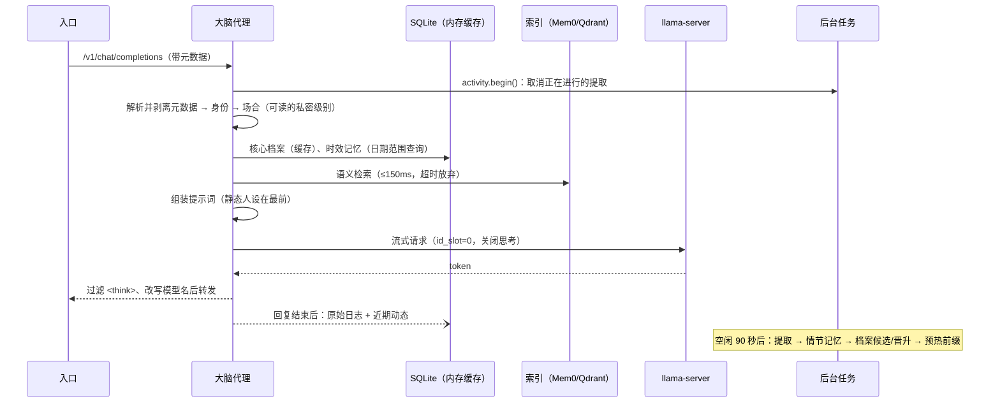

# 第一阶段详细设计

本文是对 [架构文档](architecture.md) 的细化，描述代码实际怎样实现。凡是与架构文档不同、或架构文档没有写到的地方，都在第 1 节集中说明原因。

## 1. 与架构文档的差异和补充

| # | 架构文档 | 实际实现 | 原因 |
| --- | --- | --- | --- |
| 1 | Mem0 用 LLM 比对已有记忆，决定新增、更新、删除 | Mem0 只做向量存储与检索（`infer=False`）。事实提取由本项目的提取器完成，一批日志只调用一次 LLM。纠错由“档案晋升 + 事件版本”负责 | 当前 Mem0 OSS 2.x（实测 2.2.1）的 `add()` 已改成“只追加”流水线，不再做 UPDATE/DELETE 判断，文档描述的机制已不存在。自己提取还能同时标出重要度、私密度、日期、属性槽位，并且省掉 Mem0 内部的二次 LLM 调用 |
| 2 | 情节记忆存在 Qdrant（经 Mem0） | SQLite 中的 `episodic_memory` 表是**权威副本**，Qdrant 只是索引 | 版本回滚、软删除、来源追溯、时间范围查询都需要可靠的结构化存储。索引损坏时可以从 SQLite 重建（`python -m her_brain reindex`） |
| 3 | 检索与当前消息相关的记忆 | 语义检索之外，增加**时效记忆**：日期落在前后 2 天内的计划和事件会被主动带上 | 图 6 里“我回来了”和“明天要去面试”在语义上毫不相关，单靠相似度检索不可能命中。提取器会把“明天”换算成具体日期，读路径按日期范围查询（亚毫秒） |
| 4 | 每次更新或删除都留旧版本 | 每次变更写一条 `memory_event`，保存前后快照。既能撤销任意一次变更，也能把某个用户的记忆整体恢复到任意时间点 | 满足“任意一次错误更新都能回滚” |
| 5 | 重要事实多次确认才进核心档案 | 档案候选表 + 属性槽位：同一事实在**不同批次的日志**里出现 N 次（默认 2）才晋升；同一槽位（如“所在城市”）的新值同样需要确认，确认后替换旧值，并把描述旧值的情节记忆标为“可能已过时” | 一次错误提取不会覆盖已确认的事实；重复处理同一批日志不会重复计数 |
| 6 | 提示词前缀缓存 | 额外做了两件事：用 llama-server 的 `id_slot` 把对话和后台提取固定在不同槽位；后台任务结束、人设重载后**预热**静态前缀 | 单槽位时，后台提取会冲掉对话的 KV 缓存，下一次对话要重新计算整段人设 |
| 7 | 显卡忙时暂停后台任务 | 对话请求一到，**立即取消**正在进行的提取请求（上游随即中止生成），被打断的日志保持待处理 | “暂停”只能防止开始新任务，取消才能让显卡马上空出来 |
| 8 | AstrBot 插件在请求里加 `metadata` | 插件把 `<her-meta>{json}</her-meta>` 追加到系统提示词，代理解析后删除 | AstrBot 的 `ProviderRequest` 没有按请求附加自定义字段的位置；系统提示词不会写进 AstrBot 的对话历史 |
| 9 | 枫云 TTS 使用流式 | 枫云社区版的 `chat_llm` 是非流式调用，“流式语音合成”只是把整段回复切句后依次合成 | 语音延迟 ≈ ASR + **整段**回复生成 + 第一句 TTS。代理侧通过限制语音回复长度来控制；完全流式需要改造枫云的播放线程，提供了 `her_bridge.py` 作为第 6 步的基础 |
| 10 | — | 枫云 `function_llm`（意图识别、绘画提示词等）也走同一个自定义 API。补丁把它标记为 `mode: raw`：原样透传，不注入人设、不记录 | 否则工具类调用会被注入人设、产生无意义的记忆 |
| 11 | 声纹结果 `speaker_verified` | 枫云开启声纹识别后，非主人的语音在 ASR 阶段就被丢弃。因此补丁里 `speaker_verified = 声纹识别已开启` | 与枫云现有逻辑一致，不需要额外改 ASR 代码 |
| 12 | Mem0 | 强制关闭 Mem0 的匿名遥测（PostHog） | 数据不出本机 |

## 2. 目录结构

```
her_brain/
├── api/            OpenAI 兼容接口（openai_compat.py）、管理接口（admin.py）、鉴权
├── identity/       元数据解析（metadata.py）、身份解析与场合判定（resolver.py）
├── memory/
│   ├── db.py           SQLite 表结构
│   ├── profile.py      核心档案（第一层）+ 版本
│   ├── candidates.py   档案候选与晋升
│   ├── episodic/       情节记忆（第二层）：权威副本 + 索引（mem0_index.py / lite.py）+ 事件
│   ├── rawlog.py       原始日志（第三层）
│   ├── recent.py       跨入口近期动态
│   └── retrieval.py    读路径汇总（带超时）
├── prompt/         人设（persona.py）、提示词组装（builder.py）
├── llm/            上游流式客户端、<think> 过滤、嵌入客户端
├── worker/         活动追踪（可打断）、提取器、后台调度
├── extensions/     扩展点（小鸭占位）
├── proxy.py        对话主流程
├── services.py     装配
├── backup.py       快照与恢复
└── devtools/       假 LLM 服务（测试与无 GPU 联调）
integrations/       AstrBot 插件、枫云补丁与辅助函数
scripts/            测速基线、代理开销、记忆回归
deploy/             llama-server / 嵌入 / Qdrant / 代理启动脚本
```

## 3. 一次对话的生命周期



入口中途断开（例如语音被打断）时，代理立即关闭上游连接，llama-server 停止生成；已经说出口的半句话仍会记录，并标记 `interrupted`。

## 4. 元数据协议

| 字段 | 说明 |
| --- | --- |
| `channel` | 入口：`qq` / `voice` / `discord` / `duck` …（`platform` 会经 `platform_aliases` 映射成 channel） |
| `scene` | `private` / `group` / `voice`；缺省时按 channel 和是否有 group_id 推断 |
| `external_user_id` | 入口内的用户 ID（QQ 号；语音为 `owner`） |
| `user_name` | 显示名（访客的显示名会随之更新） |
| `group_id` / `group_name` | 群号与群名 |
| `speaker_verified` | 语音入口：声纹是否确认为主人 |
| `mode` | `chat`（默认）/ `raw`（原样透传） |
| `no_memory` / `no_log` | 只记日志不提取 / 完全不落库 |

来源优先级（后者覆盖前者）：API Key 对应的入口默认值 → 消息中的标记 `<her-meta>{...}</her-meta>` 或 `[[her:k=v;k=v]]` → 请求体顶层 `metadata`。所有标记都会从**全部**消息中删除，上游看不到。入口系统提示词里的 `/no_think` 等思考开关也会被去掉，思考模式由代理统一控制。

## 5. 身份与场合

| 情况 | user_id | 可读级别 | 写入私密度 | 提取记忆 |
| --- | --- | --- | --- | --- |
| 已绑定的 QQ 号私聊 | `owner` 等 | 公开 + 私密 | 私密 | 是 |
| 已绑定的 QQ 号在群里 | 同上 | 仅公开 | 公开 | 是 |
| 未绑定的 QQ 号 | `qq:<号码>`（自动建访客） | 按场景 | 按场景 | `remember_guests` |
| 语音，声纹已确认 | `owner` | 公开 + 私密 | 私密 | 是 |
| 语音，声纹未确认 | `anon:voice` | 仅公开 | — | 否 |
| 拿不到外部 ID | `anon:<channel>` | 仅公开 | — | 否 |

“她自己”的档案与记忆使用 `user_id = _self`，每次都与当前用户一起检索，同样按私密度过滤。

## 6. 三层记忆

### 6.1 核心档案（第一层，每次必注入）

- 条目：`text, slot, value, kind, privacy, pinned, confirmations, source_log_ids, event_date`。
- 每次改写都把完整内容存入 `profile_version`；回滚到 vN 会生成一个新版本，历史不丢失。
- 渲染时按场合过滤私密度；置顶优先，其次按确认次数；超过字数预算截断。计划类条目在日期过后 3 天不再注入，空闲整理时移除（仍保留在历史版本中）。
- 内存缓存，读取为微秒级。

### 6.2 档案晋升

```
提取出的事实（kind ∈ 属性/喜好/关系，或带 slot，或明确要求记住）
  → 规范化 slot（“工作/职位”→“职业”，“城市/住址”→“所在城市”…）
  → 在同一用户、同一 slot 的候选中找“同值”（取值或文本相似度 ≥ 0.55）
     找到：若这批日志之前没计过数，确认次数 +1；否则不变（幂等）
     找不到：新建候选（确认 1 次）
  → 待定候选的确认次数 ≥ 2，或被明确要求记住 → 晋升
       有 slot：替换档案中同 slot 的旧条目；旧候选标为 superseded；描述旧值的情节记忆标为“可能已过时”
       无 slot：与相似条目合并，否则新增
  → 同一事实只要在公开场合出现过，就改为公开
```

### 6.3 情节记忆（第二层，按需检索）

- 写入：先按原文精确匹配，再用索引检索近似项（文本 Dice ≥ 0.8，或 Mem0 分数 ≥ 0.92）判断是否重复。重复时只累计提及次数、略升重要度，并合并来源；否则写入索引，同时写权威副本。
- 每次变更（ADD / UPDATE / DELETE / RESTORE / REVERT / ROLLBACK）都写一条 `memory_event`，保存前后快照。
  - `revert_event(id)`：把这条记忆恢复成该事件之前的样子（新增事件则软删除）。
  - `rollback_user(user, t)`：对 t 之后被改动过的每条记忆，恢复为它在 t 之后第一次变更前的快照。这种按快照恢复的方式不依赖撤销链，即使中间有撤销操作也能得到正确结果。
- 删除是软删除，只改 SQLite 的标记，索引不动；检索结果按权威副本过滤。`purge` 才是彻底删除（不可撤销）。
- 两种索引：
  - `mem0`（推荐）：Mem0 2.x + Qdrant + 嵌入模型。检索为向量 + BM25 + 实体的混合打分，不调用 LLM。
  - `lite`：纯 SQLite。中文按字符二元组做 IDF 加权的“查询覆盖率”打分，可选叠加嵌入向量。用于开发、测试，或没有嵌入模型时作退路。

### 6.4 原始日志（第三层，全部留底）

状态：`0 待处理 → 1 已处理 / 2 跳过 / 3 失败`。失败会重试，默认 3 次后标为失败，可通过管理接口重新排队。每条记忆和每个档案候选都记录来源日志 ID，可以对照原文重新提取；`/admin/users/{id}/rebuild` 可以从原始日志整体重建某个用户的情节记忆（旧记忆软删除，可回滚）。

### 6.5 读路径

| 内容 | 来源 | 耗时 |
| --- | --- | --- |
| 当前用户与她自己的核心档案 | 内存缓存 | 微秒级 |
| 时效记忆（±2 天的计划/事件，最多 3 条） | SQLite 范围查询 | 亚毫秒 |
| 语义检索（top 5） | 索引；超过 150ms 放弃 | Mem0 ≈ 嵌入 + Qdrant |
| 跨入口近期动态（12 小时内、最多 4 条，排除当前对话窗口） | 内存 | 微秒级 |

短于 2 个字的消息（“嗯”“好”）不做语义检索。时效记忆排在语义结果之前；最终最多 5 条，按字数预算截断。

## 7. 提示词结构

```
# 你是谁 …… # 行为规则 ……（含内置的“如何使用记忆”规则）   ← [1][2] 静态，逐字节不变
# 本轮动态信息（每轮都会变化）
## 当前场景        入口、时间、正在说话的人（身份）、公开场合提醒      ← [3]
## 关于小明         核心档案                                       ← [4]
## 关于你自己（小E）                                                ← [4]
## 你记得的相关事情  [昨天记下 · 事情在今天（2026-11-05）]……         ← [5]
## 其他入口的近期对话 25分钟前（QQ私聊）小明说「…」，你回「…」        ← [6]
## 入口附加说明      入口自带的系统提示词（如有）
（入口传来的对话历史与本轮消息）                                     ← [7]
```

`prompt.dynamic_position: before_last_user` 时，动态部分会作为一条 system 消息插在最后一条用户消息之前。这样“静态人设 + 历史对话”都能命中前缀缓存，可在第 6 步体验调优时对比。

## 8. 后台任务

- 调度：每 5 秒检查一次；距离最后一次对话满 90 秒才开始。每批取同一用户、同一私密度的最多 8 条日志。
- 提取（可打断）：一次 LLM 调用，`response_format` 使用 JSON Schema（llama-server 会转成语法约束），温度 0.1。提示词里**不放已有档案**，避免模型把已知信息复述成“新确认”。相对日期按每段对话的时间换算成具体日期。
- 写入（不可打断）：情节记忆 → 档案候选/晋升 → 标记日志已处理。整段在 `asyncio.shield` 中执行，一批日志要么全部生效，要么整批重试（重试是幂等的）。
- 没有待处理日志时：预热前缀（如有需要）→ 每日快照（默认 04:30 之后）→ 空闲整理（每 6 小时：过期只出现过一次的旧候选、移除过期计划）。

## 9. 延迟预算与代理侧手段

| 手段 | 位置 |
| --- | --- |
| 静态前缀在最前且逐字节不变；启动、重载人设、后台任务后预热 | `prompt/builder.py`、`services.warmup` |
| 对话与后台提取使用不同槽位（`id_slot`） | `upstream.slot_id`、`worker_llm.slot_id` |
| 检索 150ms 超时；短消息不检索 | `memory/retrieval.py` |
| 全程流式转发；入口断开立即中止上游 | `proxy.py`、`api/openai_compat.py` |
| 关闭思考模式，并兜底过滤 `<think>` | `llm/client.py`、`llm/think.py` |
| 回复后才落库；提取在空闲时进行，对话来了立即让路 | `proxy.finish`、`worker/` |
| 按场景限制回复长度（语音默认 200 token） | `upstream.scene_params` |

可观测性：每轮在日志中输出准备耗时、检索耗时、首字时间、总耗时；`/admin/stats` 给出 p50/p95；响应头带 `X-Her-Prepare-Ms` 和 `X-Her-Retrieval-Ms`。

## 10. 稳定性措施对照

| 架构文档的要求 | 实现 |
| --- | --- |
| 写入不在回复路径上 | 回复结束后才写原始日志（流式在发送 `[DONE]` 之后；非流式用后台任务在响应发出后执行） |
| 每次更新或删除都留旧版本 | 核心档案 `profile_version`；情节记忆 `memory_event` 前后快照 |
| 重要事实需要多次确认 | 档案候选（第 6.2 节） |
| 来源可追溯 | 记忆、候选、档案条目都带 `source_log_ids`；`GET /admin/memories/{id}` 直接附上原文 |
| 私密度在写入时标注 | 私聊、语音标为私密，群聊标为公开；读取时按场合过滤（档案、记忆、近期动态都过滤） |
| 回归测试 | `scripts/memory_regression.py` + `regression/cases.example.yaml` |
| 数据可备份可回滚 | 每日快照（第 11 节）+ 事件级回滚 + 档案版本回滚 |

## 11. 备份与恢复

每日快照默认在 04:30 之后、空闲时进行，保留 14 天：

```
backups/20261104-043012-daily/
├── brain.db            SQLite 在线备份（全部结构化数据，含情节记忆权威副本）
├── persona/her.yaml
├── config.yaml
├── mem0_history.db
├── qdrant/…snapshot    使用 Qdrant 服务时的集合快照（尽力而为）
└── manifest.json
```

恢复（先停止代理）：`python -m her_brain restore --yesterday` 或 `python -m her_brain restore <快照目录>`。恢复前会把当前数据另存到 `backups/pre-restore-*`，恢复后自动按 SQLite 重建向量索引，所以 Qdrant 快照只是加速手段，不是必需品。

## 12. 管理接口

| 方法与路径 | 作用 |
| --- | --- |
| `GET /admin/stats` | 延迟统计、后台任务状态、记忆数量 |
| `POST /admin/persona/reload` | 重载人设（失败时保留旧版本） |
| `GET/POST /admin/users`、`POST /admin/identities` | 查看用户、绑定平台身份（`move_logs` 迁移访客日志） |
| `GET/PUT /admin/users/{id}/profile`、`…/profile/entries[/{eid}]` | 查看、编辑核心档案 |
| `GET …/profile/versions`、`POST …/profile/rollback` | 档案历史与回滚 |
| `GET /admin/users/{id}/candidates`、`POST /admin/candidates/{cid}/promote|reject` | 档案候选 |
| `GET/POST /admin/users/{id}/memories`、`PATCH/DELETE /admin/memories/{mid}`、`POST …/restore` | 情节记忆（`?q=…&semantic=true` 做语义检索） |
| `GET /admin/memory-events`、`POST /admin/memory-events/{eid}/revert` | 变更事件与撤销 |
| `POST /admin/users/{id}/memories/rollback` | 整体回滚到某个时间点 |
| `POST /admin/users/{id}/rebuild`、`POST /admin/reindex` | 从原始日志重建、重建向量索引 |
| `GET /admin/logs`、`POST /admin/logs/reprocess` | 原始日志与重新提取 |
| `GET /admin/worker`、`POST /admin/worker/run|tidy` | 后台任务 |
| `POST /admin/backup`、`GET /admin/backups` | 快照 |
| `POST /admin/debug/prompt` | 按真实请求组装提示词但不调用模型 |

## 13. 扩展点（下一阶段）

`her_brain/extensions/`：`prompt_sections`（追加动态信息，例如小鸭的可用动作）与 `on_reply`（回复后处理，例如解析 `<action>{json}</action>` 并通过 MQTT 发布）。`extensions/duck.py` 给出了动作意图的解析函数与占位实现，默认不启用。小鸭作为新入口时，只需 `channel: duck`，身份、记忆、人设全部复用。

## 14. 验收清单

| 步骤 | 验收方法 |
| --- | --- |
| 1 测速基线 | `python scripts/bench_baseline.py --llm … --embed … --tts …`：首 token < 500ms，三者常驻后显存仍有余量 |
| 2 数据层 | `python -m her_brain init`；`POST /admin/backup`；`python -m her_brain restore --yesterday` |
| 3 最小代理 | 两个入口都能对话；`python scripts/bench_proxy.py`：代理准备耗时 < 50ms |
| 4 接入记忆 | 复现图 6（单元测试 `tests/test_worker_flow.py::test_figure6_cross_entry_memory` 已覆盖）；`bench_proxy.py` 检索耗时 < 150ms |
| 5 稳定性 | `scripts/memory_regression.py` 通过率稳定；任意错误更新可用 `revert` / `rollback` 撤销 |
| 6 体验调优 | 实测语音全链路；按需切换 `dynamic_position`、改造枫云流式播放 |

## 15. 已知限制

- 提取质量取决于本地模型。14B 级模型偶尔会漏提或把对方的话理解错。多次确认机制只能防止错误事实进入核心档案，情节记忆仍可能有个别错误条目，可通过管理接口删除或撤销。
- 轻量引擎（`lite`）没有真正的语义理解，只在开发或退路时使用；正式部署请使用 `mem0` + 嵌入模型。
- 每日快照里的 Qdrant 快照在使用本地嵌入模式（`qdrant_path`）时不生成；恢复时会从 SQLite 重建索引，不影响数据完整性。
- 枫云社区版完整流式需要改造其音频播放线程，本阶段只提供了切句工具与接入说明。
